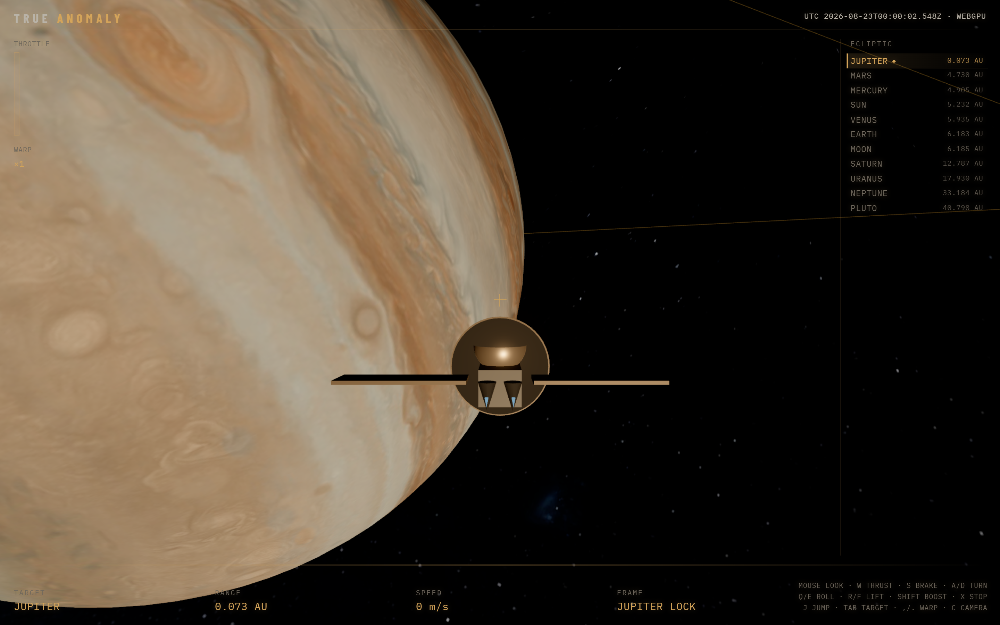
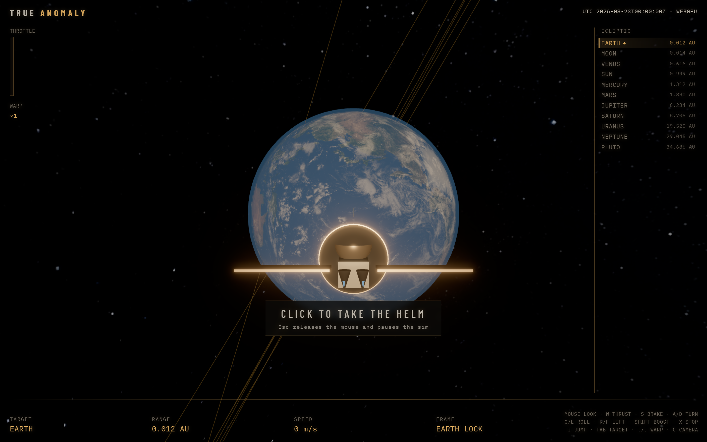
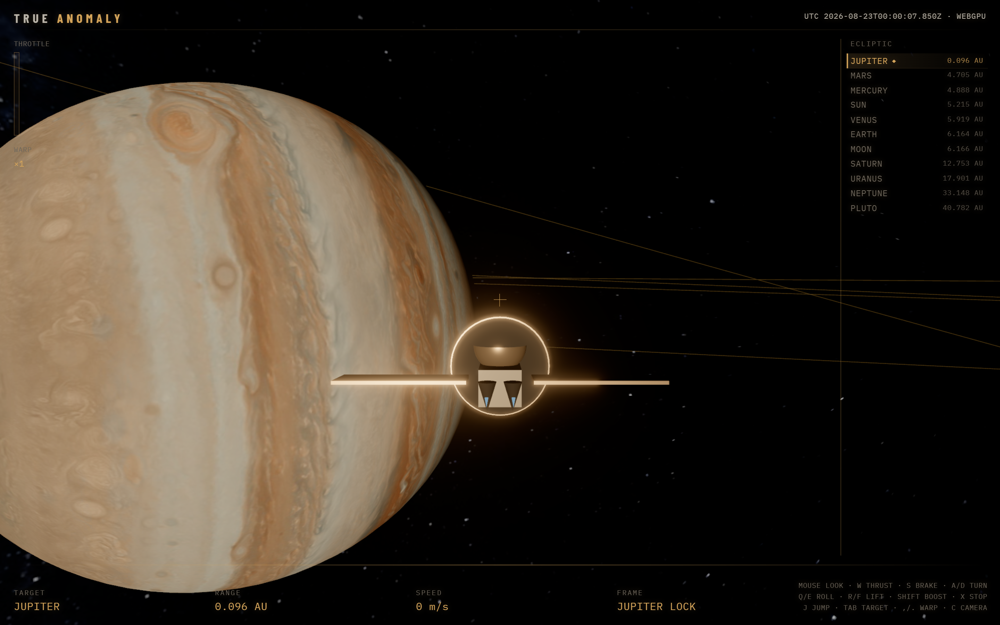
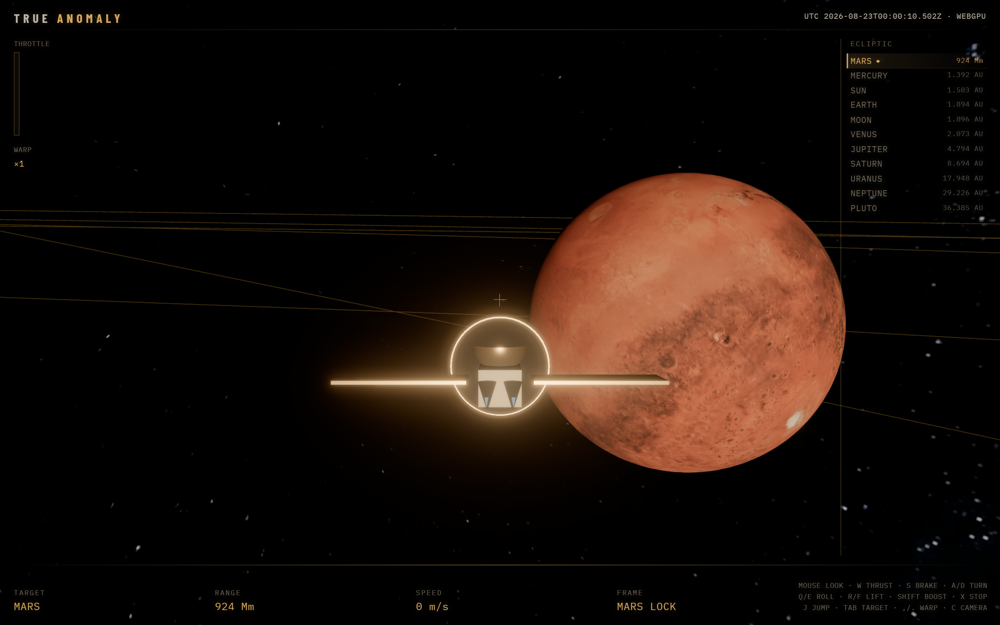
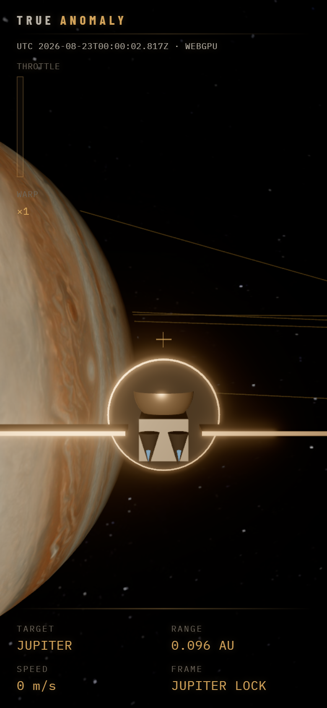

# True Anomaly



**Fly a 6DOF probe through a real-scale solar system in the browser, with every planet placed from NASA/JPL Horizons data.**


Custom Three.js WebGPU engine, planet positions from NASA/JPL Horizons, propagated with a Kepler solver. This is a non-AI side project: graphics, orbital mechanics and a small game loop.

## Highlights

- **Real ephemeris, baked offline.** Horizons state vectors are converted to orbital elements and propagated in the browser with a Newton-iteration Kepler solver.
- **True-kilometre simulation.** Physics runs in km and km/s; only the renderer scales, so the HUD reports real AU and km.
- **WebGPU first.** Three.js `WebGPURenderer` with AgX tone mapping and a post-processing pass, falling back to WebGL when WebGPU is unavailable.
- **Flight model.** 6DOF controls, boost, autopilot jump to any body, auto reference-frame lock and time warp up to x100,000.
- **Instrument HUD.** Throttle tape, live UTC from the sim epoch, target range and speed, and a body list sorted by distance.

## Screenshots

All shots are the real app running in Chrome with WebGPU. The ship was placed with `scripts/capture-screenshots.cjs` rather than flown there by hand; planet positions are the baked Horizons catalog.

| | |
|---|---|
|  |  |
| Spawn point near Earth, before the mouse is captured | Jupiter flyby, frame locked to Jupiter |
|  | |
| Mars approach, range in megametres | |

<p align="center"><br /><sub>Narrow screens get a compact HUD (flying still needs a keyboard and mouse).</sub></p>

## Why it's interesting

- Real data: body states come from the JPL Horizons API and are baked into `public/data/bodies.json` (epoch, physical parameters, orbital elements).
- Orbits are propagated with a Newton-iteration Kepler solver (`src/sim/kepler.ts`), with a runnable sanity check (`npm run check`).
- The simulation stores true kilometres; only the renderer applies a display scale, so HUD ranges read in real AU/km.
- Runs on Three.js `WebGPURenderer` (`three/webgpu`) with a post-processing pipeline (`src/render/Post.ts`).
- Ship flight model: 6DOF controls, boost, brake, autopilot jump to a selected body, reference-frame lock and time warp.

## Run

```bash
npm install
npm run bake    # optional: fetch fresh Horizons data and textures
npm run dev
```

Use a browser with WebGPU (recent Chrome/Edge). Click the canvas to capture the mouse.

Other scripts: `npm run build` (typecheck + production build), `npm run check` (Kepler solver check).

The README screenshots come from `scripts/capture-screenshots.cjs`. It needs Playwright (not a project dependency) and desktop Chrome, and runs Chrome headed because headless Chrome loses the WebGPU device; see the header comment for usage.

## Controls

| Key | Action |
|---|---|
| Mouse | Look (nose follows, FPS Y) |
| W | Thrust forward (hold) |
| S | Brake / reverse (hold) |
| A / D | Turn |
| Q / E | Roll |
| R / F | Lift / sink |
| Shift or Space | Boost |
| J | Jump toward selected body |
| Tab | Next nearest target |
| L | Reference-frame lock |
| , / . | Time warp |
| C | Chase / cockpit |
| X | Full stop |
| Esc | Release mouse |

## How the data is fetched and baked

`scripts/bake-sol.mjs` (`npm run bake`):

1. Requests daily state vectors (ecliptic plane, km and km/s) for the Sun, planets, Moon and Pluto from the JPL Horizons API and converts them to orbital elements.
2. Adds physical parameters (radius, flattening, rotation period, obliquity, GM) and writes `public/data/bodies.json` and `public/data/SOURCES.md`.
3. Downloads 2K planet textures from Solar System Scope and the latest Sun images from NASA SDO into `public/textures/`.

If the network is unavailable, mean J2000 fallback elements in the script keep the game bootable. A baked catalog and textures are already checked in, so the bake is optional.

## Scale

The simulation uses true kilometres. Display uses 1 AU = 4000 units, planet radii x80, Sun x28 so Mercury's orbit stays clear of the photosphere.

## Credits

- Ephemeris and physical constants: NASA/JPL Horizons System and JPL Solar System Dynamics (https://ssd.jpl.nasa.gov/). NASA/JPL data is generally public domain; please credit NASA/JPL.
- Planet, Moon, Sun and Milky Way textures: Solar System Scope (https://www.solarsystemscope.com/textures/), based on NASA imagery, licensed CC BY 4.0. Attribution required.
- Live solar disk images (AIA 171, HMI intensitygram): NASA Solar Dynamics Observatory (https://sdo.gsfc.nasa.gov/).
- Engine: [three.js](https://threejs.org/) (MIT).

## License

MIT, see `LICENSE`. Third-party data and textures keep their own terms as listed above.
